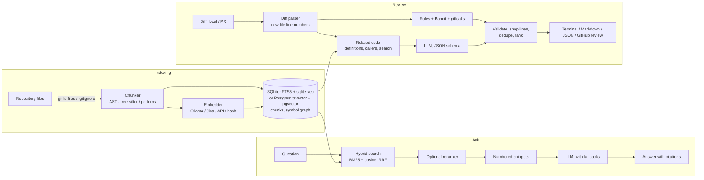

# RepoScout

**Ask questions about any codebase, and get AI code reviews on pull requests. Runs entirely on free tools: local models through Ollama, SQLite, and GitHub's free API.**

Example session (illustrative; the exact wording depends on the model):

```
$ reposcout ask "how are webhook signatures verified?"
Incoming webhooks are checked in `verify_signature` in src/reposcout/github.py: it computes an
HMAC-SHA256 of the raw request body with the shared secret and compares it to the
X-Hub-Signature-256 header using a constant-time comparison [1]. The server rejects the
request with 401 if the check fails [2].

Sources:
 *[1] src/reposcout/github.py:47-52  verify_signature
 *[2] src/reposcout/server.py:198-231  create_app.github_webhook

$ reposcout review --git main
Reviewed 1 file(s) (+4/-0): 1 major.
  src/billing.py: Adds a discount helper.

[MAJOR] src/billing.py:67  Discount can exceed price  (bug, llm)
    A discount larger than the price makes the total negative.
    > return max(price - discount, 0)
```

## What it does

| | |
|---|---|
| **Ask** | Natural-language questions about a repository, answered from the actual code with citations to file and line ranges. |
| **Search** | Hybrid code search: keyword (BM25) and semantic (embeddings) results fused into one ranking. |
| **Review** | Reviews a diff (your working tree, a branch, a diff file, or a GitHub PR) with fast deterministic rules plus an LLM that sees related code from the rest of the repo. |
| **PR bot** | Posts the review as inline comments on GitHub, from the CLI, a GitHub Action, or a webhook server. |
| **Web UI + API** | A small web page and a JSON API for all of the above. The public version has optional **Sign in with GitHub**, and each person sees only their own repositories. |
| **Evals** | Built-in evaluation harness with labelled datasets, so quality changes are measured, not guessed. |

## Engineering highlights

- **Code-aware chunking.** Python is parsed with the `ast` module and 13 other languages (JavaScript/TypeScript, Go, Rust, Java, Kotlin, Scala, C#, Swift, C/C++, Ruby, PHP) with [tree-sitter](https://tree-sitter.github.io), so every chunk is a whole function, method or class with its doc comment, decorators or `export` (long ones are split along their nested definitions). Markdown, SQL and shell use definition-line detection, which is also the fallback when a grammar can't be loaded; everything else falls back to overlapping windows.
- **Symbol graph.** Each chunk records the functions it calls (tree-sitter tags queries, the same ones GitHub's code navigation uses), so "who calls `verify_token`?" is an index lookup. The reviewer uses it to show the model the callers of a changed function.
- **Hybrid retrieval with Reciprocal Rank Fusion.** SQLite FTS5 (BM25, Porter stemming, identifiers split so `getUserId` matches "user id") is combined with cosine similarity over embeddings. RRF merges the two rankings without having to calibrate their scores.
- **Source-first ranking.** Tests and docs mention the same words as the code they describe, so they are down-weighted unless the question is about tests or docs. On the bundled eval this raised recall@5 from 0.55 to 0.80.
- **Incremental indexing.** Files are hashed (SHA-256); re-indexing only re-embeds files that changed and removes deleted ones. Index schema and chunker versions are tracked so upgrades rebuild automatically, and an index built with one embedding model refuses to be queried with another.
- **No vector database to run.** Locally, vectors live in the same SQLite file and are searched with [sqlite-vec](https://github.com/asg017/sqlite-vec) (NumPy when the extension isn't available). The public app can keep every index in one Postgres database instead (pgvector `halfvec` + `tsvector`, e.g. Neon's free tier), so hosts that wipe their disk on restart, like Render's free plan, keep their indexes.
- **Optional reranking.** A cross-encoder (Jina's reranker API) can re-order the top 30 hybrid results; it never breaks search if the API is down.
- **Rules + scanners + LLM review.** 16 deterministic rules (secrets, SQL injection, `shell=True`, disabled TLS checks, unsafe YAML/pickle, debugger statements, XSS sinks...) run on every added line in milliseconds, next to [Bandit](https://bandit.readthedocs.io) (reads the whole changed Python file) and [gitleaks](https://github.com/gitleaks/gitleaks) (~200 secret formats). [Semgrep](https://semgrep.dev) can be switched on too and runs in CI. The LLM handles logic bugs. Duplicates are merged, with rules winning ties, and only lines the change adds are reported.
- **Hallucination guards.** The model must return JSON matching a Pydantic schema; invalid items are dropped individually. Findings that point at lines not in the diff are snapped to the nearest added line (within 3) or discarded, and every drop is counted in the review stats.
- **Cross-file context.** For each changed file, the reviewer looks up the definitions of functions the change calls and the callers of functions it modifies, and adds them to the prompt, so the model can see signatures, behaviour and breakage it would otherwise guess.
- **Production details.** A fallback chain across free LLM providers (Groq, Gemini, OpenRouter, Cerebras) when one is rate limited, optional Sentry error tracking and Langfuse LLM traces, parallel per-file review, retries with backoff that honour `Retry-After`, HMAC-verified and idempotent webhooks (GitHub re-deliveries never produce duplicate reviews), a fallback to a summary review if GitHub rejects an inline comment position, per-route latency metrics, and a `--fail-on` exit code for CI gates.

## Quick start (free, local)

You need Python 3.10+ and git. Models run locally through [Ollama](https://ollama.com), which is free.

```bash
# 1. Install Ollama from https://ollama.com/download, then pull two models
ollama pull nomic-embed-text      # embeddings (~270 MB)
ollama pull qwen2.5-coder:7b      # chat/review model (~4.7 GB, needs ~8 GB RAM)
                                  # low on RAM? use qwen2.5-coder:3b or :1.5b

# 2. Install RepoScout (with uv: https://docs.astral.sh/uv/)
git clone <your-repo-url> reposcout && cd reposcout
uv sync --all-extras                                 # creates .venv with everything
source .venv/bin/activate                            # Windows: .venv\Scripts\activate
npm --prefix frontend ci && npm --prefix frontend run build   # the web UI (needs Node 22+)
# Without uv: python -m venv .venv && pip install -e ".[dev]"

# 3. Index a repository and use it
reposcout index --repo /path/to/some/project
reposcout ask "where is authentication handled?" --repo /path/to/some/project
reposcout review --git main --repo /path/to/some/project
reposcout serve --repo /path/to/some/project          # web UI on http://127.0.0.1:8000
```

Any coding model from the [Ollama library](https://ollama.com/library) works: set `REPOSCOUT_LLM_MODEL`. With more RAM, a newer coder model (the Qwen3-Coder family) gives better answers and fewer wrong review comments. For better code search, `ollama pull qwen3-embedding:0.6b` and set `REPOSCOUT_EMBED_MODEL=qwen3-embedding:0.6b` (then `reposcout index --rebuild`).

**No models at all?** Everything except LLM answers works offline:

```bash
reposcout index --embed-provider hash          # model-free lexical embeddings
reposcout search "retry with backoff" --embed-provider hash
reposcout review --staged --no-llm             # rules-only review
```

### Using a hosted API instead of Ollama

Any OpenAI-compatible API works (Groq, Google Gemini's OpenAI endpoint, OpenRouter, LM Studio, vLLM...). Several have free tiers; check the provider's current limits and model names.

```bash
export REPOSCOUT_LLM_PROVIDER=openai
export REPOSCOUT_OPENAI_BASE_URL=https://api.groq.com/openai/v1
export REPOSCOUT_OPENAI_API_KEY=your-key
export REPOSCOUT_LLM_MODEL=llama-3.3-70b-versatile

# Optional: models to try when the main one is rate limited or down
export REPOSCOUT_LLM_FALLBACKS="gemini:gemini-2.5-flash,openrouter:qwen/qwen3-coder:free"
export GEMINI_API_KEY=... OPENROUTER_API_KEY=...

# Optional: hosted code embeddings and reranking (free tokens, non-commercial use)
export REPOSCOUT_EMBED_PROVIDER=jina REPOSCOUT_RERANK_PROVIDER=jina JINA_API_KEY=...
```

Free-tier limits and model names change often; check each provider's current ones.

## Commands

| Command | What it does |
|---|---|
| `reposcout index [--rebuild]` | Index the repository (incremental by default). |
| `reposcout ask "question" [--no-llm] [--json]` | Answer a question with cited sources. |
| `reposcout search "query" [-k 8]` | Hybrid code search. |
| `reposcout review [--git BASE \| --staged \| --diff FILE]` | Review local changes. Defaults to uncommitted changes vs `HEAD`. |
| `reposcout review-pr owner/repo#12 [--post [--yes]]` | Review a GitHub PR; `--post` publishes it as PR comments after asking you to confirm (`--yes` skips the question, for CI). |
| `reposcout serve [--host --port]` | Web UI, JSON API and GitHub webhook receiver. |
| `reposcout serve-public [--host --port]` | The public multi-repository app (visitors bring their own API key); deploy it on [Render + Neon](docs/DEPLOY-RENDER.md) (free) or [your own server](docs/DEPLOY.md). |
| `reposcout grammars` | Download the tree-sitter grammars ahead of time (Docker images, offline use). |
| `reposcout eval retrieval\|review DATASET` | Measure quality on a labelled dataset. |
| `reposcout status` | Index statistics. |

Review options: `--no-llm`, `--no-context`, `--format text|markdown|json`, `--min-severity nit|minor|major|critical`, `--fail-on SEVERITY` (exit code 1 for CI).

## GitHub integration

**1. From the command line.** Create a token (fine-grained, with *Pull requests: read and write* on the repo), then:

```bash
export GITHUB_TOKEN=github_pat_...
reposcout review-pr octo/shop#42 --post    # shows the review, then asks before posting
```

Posting always asks first, naming the pull request and the account the comments will appear under. Only post on repositories you maintain or where the maintainers asked for it; unrequested automated reviews are spam under GitHub's terms.

**2. As a GitHub Action.** `.github/workflows/reposcout-review.yml` reviews every pull request in this repository. Add a repository secret `REPOSCOUT_OPENAI_API_KEY` (and optionally variables `REPOSCOUT_OPENAI_BASE_URL` / `REPOSCOUT_LLM_MODEL`) to enable LLM review; without a key it runs the rules-only review. Note that GitHub does not give secrets or write access to workflows triggered by pull requests from forks.

**3. As a webhook server.** Run `reposcout serve` with `GITHUB_TOKEN` and `REPOSCOUT_WEBHOOK_SECRET` set, then add a webhook in the repo settings: payload URL `https://<your-host>/webhooks/github`, content type `application/json`, the same secret, and the *Pull requests* event. For local testing, expose the port with a free tunnel such as `cloudflared tunnel --url http://localhost:8000`. Recent webhook reviews are listed at `GET /reviews`.

## API

| Method | Path | Body |
|---|---|---|
| `GET` | `/` | Web UI |
| `GET` | `/health` | |
| `GET` | `/stats` | Index stats, LLM token usage, per-route request counts and p50/p95 latency |
| `POST` | `/index` | `{"rebuild": false}` |
| `POST` | `/search` | `{"query": "...", "k": 8}` |
| `POST` | `/ask` | `{"question": "...", "k": 8}` |
| `POST` | `/review` | `{"diff": "...", "min_severity": "nit"}` |
| `GET` | `/reviews` | Recent webhook-triggered reviews |
| `POST` | `/webhooks/github` | GitHub webhook (HMAC-verified) |

Interactive API docs are served at `/docs`.

## Configuration

All settings are environment variables (see `.env.example`).

| Variable | Default | Meaning |
|---|---|---|
| `REPOSCOUT_REPO_PATH` | current directory | Repository to index and serve |
| `REPOSCOUT_EMBED_PROVIDER` | `ollama` | `ollama`, `jina`, `openai` or `hash` |
| `REPOSCOUT_EMBED_MODEL` | provider's default | `nomic-embed-text` (Ollama, OpenAI-compatible), `jina-embeddings-v2-base-code` (Jina) |
| `REPOSCOUT_LLM_PROVIDER` | `ollama` | `ollama` or `openai` (any OpenAI-compatible API) |
| `REPOSCOUT_LLM_MODEL` | `qwen2.5-coder:7b` | Chat model |
| `REPOSCOUT_LLM_FALLBACKS` | | Backup models, `provider:model,...` (groq, gemini, openrouter, cerebras, ollama, openai); keys from `<PROVIDER>_API_KEY` |
| `REPOSCOUT_RERANK_PROVIDER` | `none` | `none` or `jina` |
| `REPOSCOUT_JINA_API_KEY` | | Key for Jina embeddings/reranking (`JINA_API_KEY` also works) |
| `REPOSCOUT_SCANNERS` | `bandit,gitleaks` | Static analysers in reviews: any of `bandit`, `gitleaks`, `semgrep`, or `none`; missing tools are skipped |
| `REPOSCOUT_VECTOR_BACKEND` | `auto` | `auto`, `sqlite-vec` or `numpy` |
| `REPOSCOUT_OLLAMA_URL` | `http://localhost:11434` | Ollama address |
| `REPOSCOUT_OPENAI_BASE_URL` | `https://api.groq.com/openai/v1` | OpenAI-compatible endpoint |
| `REPOSCOUT_OPENAI_API_KEY` | | API key for that endpoint |
| `GITHUB_TOKEN` | | Token for reading PRs and posting reviews |
| `REPOSCOUT_WEBHOOK_SECRET` | | Shared secret for the webhook |
| `REPOSCOUT_TOP_K` | `8` | Snippets retrieved per question |
| `REPOSCOUT_CHUNK_MAX_LINES` | `80` | Longest chunk before splitting |
| `REPOSCOUT_MAX_FILE_BYTES` | `400000` | Larger files are not indexed |
| `SENTRY_DSN` | | Send errors to Sentry (`observability` extra) |
| `LANGFUSE_PUBLIC_KEY`, `LANGFUSE_SECRET_KEY` | | Trace LLM calls in Langfuse (`observability` extra) |

The public app's settings (database, limits, rate-limit storage) are listed in [docs/DEPLOY-RENDER.md](docs/DEPLOY-RENDER.md#settings-for-the-public-app).

Files listed in `.gitignore` or `.reposcoutignore` are not indexed, nor are dependencies, build output, lockfiles and binaries.

## Measuring quality

Two labelled datasets ship in `evals/`:

- `retrieval_self.json`: 20 questions about this repository's own code, each labelled with the file/function that answers it. Reports hit@1, recall@k, MRR and latency.
- `review_cases.json`: 15 diffs with seeded issues (SQL injection, leaked keys, shell injection, off-by-one, assignment-in-condition, division by zero...) plus 3 clean diffs that should produce no warnings. Reports precision, recall, F1 and the false-alarm rate on clean code.

```bash
reposcout index
reposcout eval retrieval evals/retrieval_self.json
reposcout eval review evals/review_cases.json            # rules + LLM
reposcout eval review evals/review_cases.json --no-llm   # rules only
```

Baseline numbers measured on this repository without any model (`hash` embedder, no LLM):

| Setup | Result |
|---|---|
| Review, rules only | precision 1.00, recall 0.75, F1 0.86, false-alarm rate on clean diffs 0% |
| Retrieval with source-first ranking | hit@1 0.25, recall@5 0.80, MRR 0.48, p50 latency ~1 ms |
| Retrieval without source-first ranking | hit@1 0.10, recall@5 0.55, MRR 0.28 |

The three review misses in rules-only mode are logic bugs that need the LLM. Run the same commands with your chosen models to get your own numbers, and re-run them after each change.

## How it works



```
src/reposcout/
  chunking.py      code-aware chunking (ast for Python, regex fallback)
  treesitter.py    tree-sitter chunking and call references for 13 languages
  embeddings.py    Ollama, Jina, OpenAI-compatible and hashing embedders
  store.py         SQLite index, FTS5 keyword search, sqlite-vec/NumPy vector search, RRF fusion
  pg_store.py      the same index on Postgres (pgvector + tsvector) for the public app
  rerank.py        optional second-stage reranking
  observability.py Sentry and Langfuse hooks
  paths.py         test/doc detection and source-first ranking weights
  indexer.py       incremental repository indexing
  assistant.py     question answering (RAG) with citations
  llm.py           Ollama and OpenAI-compatible chat clients with retries and fallbacks
  review/          diff parser, rules, scanners (Bandit, gitleaks, Semgrep), LLM reviewer, finding schema
  github.py        PR diffs, review posting, webhook signature check
  server.py        FastAPI app: API, web UI, webhook
  web/             the public multi-repository app (workspace, limits, GitHub links)
  static_files.py  serves the built web UI (static/dist, built from frontend/)
  evaluation.py    retrieval and review metrics
  cli.py           command-line interface
frontend/          web UI: React + Vite + TypeScript, TanStack Query, Tailwind + shadcn/ui
evals/             labelled datasets
tests/             Python tests (no model or GitHub access needed)
docs/DESIGN.md     design decisions and trade-offs
```

## Development

```bash
uv sync --all-extras                         # Python, plus Postgres, scanner and monitoring extras
npm --prefix frontend ci && npm --prefix frontend run build
uv run pytest --cov                          # models and GitHub are faked
uv run ruff check src tests && uv run ruff format --check src tests
uv run pyright                               # type check
npm --prefix frontend run typecheck && npm --prefix frontend test   # Vitest
npm --prefix frontend run test:e2e           # Playwright (npx playwright install chromium once)
npm --prefix frontend run dev                # UI dev server; proxies the API to 127.0.0.1:8000
```

The Postgres tests run when `REPOSCOUT_TEST_DATABASE_URL` points at a Postgres with pgvector (e.g. `docker run -e POSTGRES_PASSWORD=pg -p 5432:5432 pgvector/pgvector:0.8.7-pg17`, then `postgresql://postgres:pg@localhost:5432/postgres`); they are skipped otherwise. Scanner tests use `gitleaks` and `semgrep` when installed. CI runs all of it, plus Semgrep over the code.

Docker: `docker compose up -d`, then `docker compose exec ollama ollama pull nomic-embed-text`, `docker compose exec ollama ollama pull qwen2.5-coder:7b`, and `docker compose exec reposcout reposcout index`. Set `REPO_TO_INDEX=/path/to/repo` to choose what is mounted.

## Limitations

- Retrieval quality depends on the embedding model; the `hash` embedder only matches words, not meaning.
- tree-sitter grammars are downloaded on first use (the Docker images include them; `reposcout grammars` fetches them ahead of time). Without them, non-Python code is chunked by definition-line patterns, which gives coarser chunks.
- The webhook server reviews PRs with context from the locally indexed checkout, which may lag behind the PR's base branch.
- Small local models produce more false positives than large hosted ones; use `--min-severity minor` to cut noise.

## License

MIT

Contributors : PRIYANSHU RANJAN & ADITYA GOYAL
